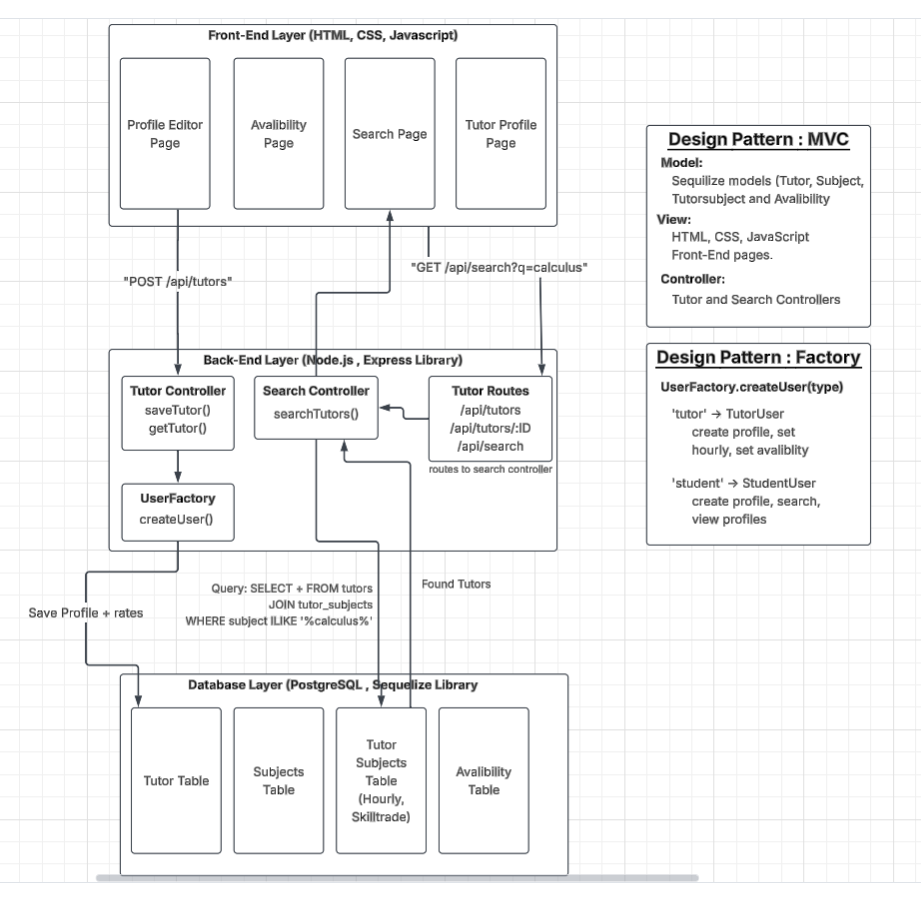

# SkillSwap--RC-

## Project Description
Skill Swap is a tutoring platform for students to connect at more times of the week easier using a platform designed to remotely schedule and get verification through ratings and credentials on tutors as well as allowing for the pupils/tutors to swap tutoring time at a rate for each subject.

The platform is meant to focus on the experience of specific tutoring and flexable time schedules for people like:
- Proffesors
- Students 
- People studiying for Certificates

The main difference in the experience compared to standard tutoring experiences is:
- It offers skill trade for skills at a rate thats fairly compensated
- It will offer remote and in person meetings for sessions
- Time slots will be avalible for booking ahead of time to offer flexible hours compared to local tutors
- A tutors credentials and ratings will be visible to students before booking a session
- Searching will be comprehensive and easy for users to make meaningful searchs quickly

# Design Chart for DB (Eventual)

# Technologies 
- HTML
- CSS
- JS
- VScode (IDE)

